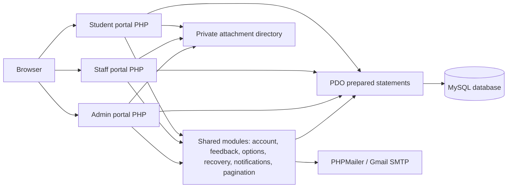
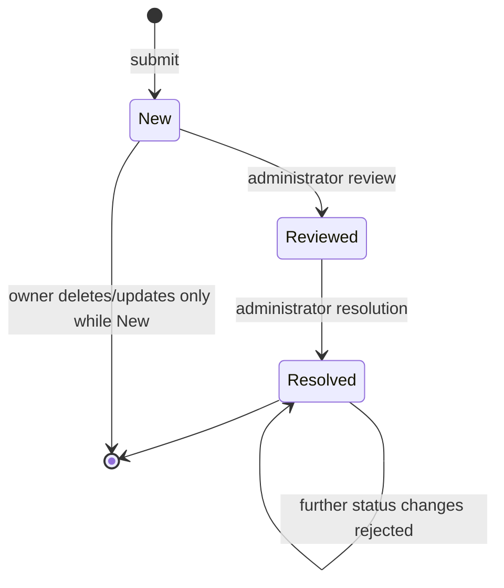
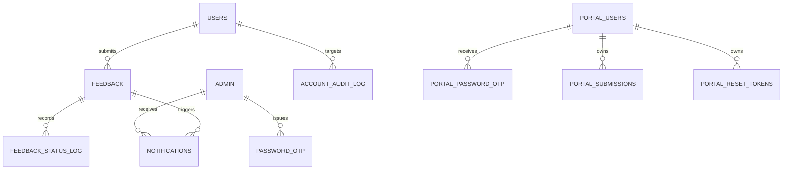

# College Online Feedback System
## Complete Evidence-Based Project Report

**Institution:** Patan Nistha Campus  
**Project:** College Online Feedback System  
**Implementation stack:** PHP 8+, MySQL/MariaDB, PDO, HTML5, CSS3, JavaScript, Composer, PHPMailer  
**Report basis:** Source code, SQL schema, migrations, README.md, PROJECT_DOCUMENTATION.md, and the current repository structure  
**Repository review date:** 13 November 2026

> This report documents what is implemented in the repository. It does not treat proposed features as completed features. The local MySQL service was unavailable during the final inspection (`Can't connect to local server through socket '/run/mysqld/mysqld.sock'`), so runtime row counts and live lookup contents could not be queried. SQL-defined values are reproduced below; live records are identified as unavailable rather than invented.

---

## Abstract

The College Online Feedback System is a role-based web application for Patan Nistha Campus. The current checkout provides a public landing page plus authenticated student and staff portals for richer, trackable feedback. Administrators can review all feedback, filter and search submissions, inspect details and attachments, update workflow status, maintain student and staff accounts, approve staff-created students, review audit history, export reports, manage their profile, receive per-administrator notifications, and recover or change passwords through email verification codes.

The application uses server-rendered PHP with PDO prepared statements and a shared MySQL database. Student and staff features are implemented through shared account, feedback, notification, profile, filtering, pagination, and recovery modules. The design emphasizes role checks, CSRF tokens, password hashing, prepared SQL, anonymous-submission handling, attachment validation, status history, and consistent portal UI.

---

## Table of Contents

1. Introduction and project background  
2. Existing-system review and rationale  
3. Scope, users, and requirements  
4. System architecture and design  
5. Repository and module inventory  
6. Functional implementation by portal  
7. End-to-end workflows  
8. Database design and SQL documentation  
9. Frontend and interaction documentation  
10. Backend routes, queries, and business rules  
11. Security, validation, and error handling  
12. Testing and verification  
13. Installation, migration, and deployment  
14. Results, limitations, and discussion  
15. Future enhancements  
16. References  
17. Appendices

---

# Chapter 1 — Introduction

## 1.1 Background

Campus feedback is useful when it is easy to submit, attributable when a response is required, anonymous when privacy is important, and actionable for management. Traditional paper or informal feedback channels make searching, prioritizing, status tracking, and historical analysis difficult. This system centralizes those activities in a web application.

## 1.2 Problem statement

The system addresses the following operational problems:

- feedback is otherwise difficult to collect in a consistent format;
- anonymous and identified responses need different privacy treatment;
- administrators need a searchable queue rather than an unstructured inbox;
- feedback needs a lifecycle (`New`, `Reviewed`, `Resolved`);
- student/staff accounts require role-specific access and approval controls;
- account and password changes need auditability and email verification;
- attachments, notifications, reports, and account records must remain linked to the same database.

## 1.3 Objectives

1. Provide a public landing page that directs users to authenticated portals.
2. Provide secure student and staff workspaces.
3. Provide an administrator dashboard for operational review.
4. Preserve anonymous feedback semantics while allowing authenticated tracking.
5. Support filtering, pagination, reporting, CSV export, and audit history.
6. Implement secure password hashing, OTP recovery, CSRF protection, and role checks.
7. Store academic information for students and institutional designation information for staff.

## 1.4 Scope

### Implemented scope

- Public landing page with links to the student and staff portals (`index.php`).
- Student login, approved-account access, feedback submission/editing/history, profile, and password flows.
- Staff login, feedback submission/editing/history, profile, student account creation, and password flows.
- Administrator login, dashboard, feedback management, status management, reports, CSV export, account management, student approval, audit log, notifications, profile, password change, and password recovery.
- MySQL persistence with migrations and seeded demonstration records.

### Explicit limitations

- The application is designed for local PHP/Apache/XAMPP deployment, not a hosted cloud service.
- The current repository does not provide a separate REST API layer; PHP page handlers and JSON endpoints act as the application endpoints.
- Email delivery requires PHPMailer and a configured Gmail App Password. Without that configuration, OTP delivery is unavailable.
- The repository contains both legacy `portal_reset_tokens` link-reset tables/scripts and the newer OTP flow. The active shared portal recovery implementation uses OTP; legacy link-reset code remains in source for compatibility.
- The README and older project guide describe a `public-portal/` directory, public feedback/contact handlers, and a public confirmation page. That directory is absent from the checked-out repository reviewed for this report, so those routes are documented as historical/not implemented here rather than as active features.
- Runtime database contents could not be verified during this report build because MySQL was stopped.

---

# Chapter 2 — Existing-System Review and Rationale

The original README describes a public portal and administrator portal. Subsequent repository changes extend that design with student and staff authentication, managed accounts, student approval, academic/employment fields, feedback attachments, status logs, notifications, profile management, shared OTP recovery, reports, and responsive filtering. The current code should therefore be treated as the authoritative specification, with the older README sections understood as historical context where they say student/staff accounts or exports are out of scope.

The implemented design follows a conventional server-rendered MVC-like separation:

- page scripts orchestrate request handling and rendering;
- shared PHP modules contain account, feedback, notification, pagination, recovery, and option logic;
- portal-specific database includes provide PDO connections and session names;
- CSS and JavaScript provide a common visual language and progressive enhancement;
- SQL migrations evolve the database without replacing the original schema.

---

# Chapter 3 — Users, Requirements, and Permissions

## 3.1 User roles

| Role | Main capabilities |
|---|---|
| Public visitor | Read the landing page and choose a Student or Staff portal. |
| Student | Sign in when active and approved; submit/edit/delete own `New` feedback; view own history; maintain profile; change or recover password. |
| Staff | Sign in when active; submit/edit/delete own `New` feedback; view own history; maintain profile; create student accounts; change or recover password. |
| Administrator | Full feedback review; status updates; deletion; detail/attachment access; reports and CSV; account CRUD; password reset; student approval; audit review; notifications; own profile/security management. |
| Campus management | Uses administrator reports and aggregate dashboard information; no separate login role is implemented. |

## 3.2 Functional requirements

| ID | Requirement | Implementation |
|---|---|---|
| FR-01 | Authenticated feedback submission | Student/staff dashboard handlers and shared `feedback` schema. |
| FR-02 | Anonymous feedback | Authenticated student/staff forms use `is_anonymous=1`, `submitter_name=NULL`, and no ordinary display of identity. |
| FR-03 | Authenticated portals | `student-portal/`, `staff-portal/`, named sessions, role checks. |
| FR-04 | Account administration | `accounts_manage.php`, `account_save.php`, `account_action.php`. |
| FR-05 | Staff-created student approval | `manage_users.php`, `student_approvals.php`, `student_approval_action.php`. |
| FR-06 | Feedback workflow | `New`, `Reviewed`, `Resolved`; status log; resolved is final in admin update logic. |
| FR-07 | Search/filter/pagination | Admin lists, reports, audit log, and portal history filters. |
| FR-08 | Notifications | `notifications` table and authenticated polling endpoints. |
| FR-09 | Password security | `password_hash`, password verification, OTP tables and mailer. |
| FR-10 | Academic/employment information | Department/faculty, semester/year, staff department and staff role using lookup options. |
| FR-11 | Attachments | JPG/JPEG/PNG/PDF, 5 MB maximum, private temporary/persistent directory. |
| FR-12 | Export | Admin report CSV export for complete or filtered report results through current report UI. |

## 3.3 Non-functional requirements

- **Security:** server-side validation, prepared SQL, password hashing, CSRF, session regeneration, role guards, safe output escaping.
- **Usability:** consistent forms, responsive layout, icons, modals, toast/alert feedback, filter panels, pagination.
- **Maintainability:** shared modules and migrations; no duplicate student/staff business logic where a shared implementation is possible.
- **Availability:** normal page behavior does not depend on JavaScript, except enhanced controls and polling.
- **Privacy:** anonymous names are not stored; attachment files are outside the web root by default; student/staff history is restricted to the logged-in user.

---

# Chapter 4 — System Architecture and Design

## 4.1 Logical architecture



## 4.2 Request lifecycle

1. Apache/PHP receives a page or form request.
2. A portal session is started where required.
3. Protected pages include the role-specific auth guard.
4. A page includes the correct PDO connection and shared helpers.
5. Inputs are read from `POST`, `GET`, `FILES`, or session state.
6. CSRF, type, length, format, permission, and business validations run server-side.
7. A prepared SQL statement runs, usually inside a transaction for multi-table changes.
8. The response is HTML, JSON, a redirect, a download, or a protected attachment stream.
9. JavaScript enhances the loaded page with tabs, dialogs, polling, timers, search, and UI feedback.

## 4.3 Use-case diagram

```mermaid
flowchart TB
  Visitor((Visitor)) --> Submit[Submit feedback]
  Visitor --> Contact[Send contact message]
  Student((Student)) --> LoginS[Student login]
  Student --> OwnFeedback[Create/edit/view own feedback]
  Student --> ProfileS[Update profile/password]
  Staff((Staff)) --> LoginT[Staff login]
  Staff --> OwnFeedbackT[Create/edit/view own feedback]
  Staff --> CreateStudent[Create student account]
  Admin((Administrator)) --> LoginA[Admin login]
  Admin --> Review[Review/filter/report feedback]
  Admin --> Status[Change feedback status]
  Admin --> Accounts[Manage accounts]
  Admin --> Approve[Approve/reject students]
  Admin --> Audit[Review audit log]
  Admin --> Notify[Read notifications]
```



## 4.4 Feedback lifecycle



---

# Chapter 5 — Repository and Module Inventory

## 5.1 Root files

| File | Responsibility |
|---|---|
| `index.php` | Landing page and entry links for public/student/staff/admin areas. |
| `README.md` | Setup, migration, credentials, OTP, notification, and security guidance. |
| `PROJECT_DOCUMENTATION.md` | Role model and migration notes. |
| `composer.json`, `composer.lock`, `vendor/` | PHPMailer dependency and Composer autoloading. |
| `assets/logo.svg` | Shared campus/application logo and favicon. |
| `confirmation_modal.php` | Shared confirmation dialog markup. |
| `list_ui.css` | Shared list/table presentation. |
| `portal_*.php/js/css` | Shared portal account, feedback, profile, sidebar, charts, pagination, notifications, recovery, filters, and select styling. |

## 5.2 Public landing page

The current checkout contains `index.php`, a standalone public landing page with campus branding, portal links, program tags, and a three-step explanation. It links to `student-portal/login.php` and `staff-portal/login.php`. There is no `public-portal/` directory in the current checkout and no active public feedback/contact submission handler. The public feedback columns in `feedback` and the older README references describe an earlier or planned public module; they are not evidence of an active route in this version.

## 5.3 Administrator portal

| Route/file | Purpose |
|---|---|
| `login.php` | Administrator sign in; password verification and session creation. The unsupported “Remember me on this device” control has been removed. |
| `logout.php` | Clears session data/cookie and redirects to login. |
| `dashboard.php` | Summary cards, charts, feedback list, search/filter/pagination, notification UI. |
| `feedback_list.php` | Dedicated/reused feedback list route. |
| `view_feedback.php`, `get_feedback_detail.php` | Detail page/JSON detail retrieval. |
| `status_update.php` | Validates and records status changes. |
| `delete_feedback.php` | Deletes feedback after confirmation. |
| `feedback_attachment.php` | Authenticated download/stream of private attachments. |
| `status_reports.php` | Report list, filters, report metrics and CSV export. |
| `accounts_manage.php` | Staff/student lists, filters, account tabs, audit-log tabs. |
| `account_save.php` | JSON account read/create/update endpoint. |
| `account_action.php` | JSON reset-password/enable/disable/delete endpoint. |
| `student_approvals.php` | Pending/approved/rejected student approval list. |
| `student_approval_action.php` | Approve/reject action and audit entry. |
| `profile.php`, `update_profile.php` | Admin profile and verified email update. |
| `forgot_password.php`, `change_password.php` | Admin OTP recovery and authenticated password change. |
| `check_new_feedback.php` | Authenticated notification polling. |
| `mark_notification_read.php`, `mark_all_notifications_read.php` | Read-state endpoints. |
| `includes/auth.php`, `db.php`, `header.php`, `footer.php` | Guard, PDO, shell layout. |
| `includes/accounts.php` | Account validation, selection, audit helpers. |
| `includes/otp.php`, `mailer.php`, `mailer.local.php` | OTP issuing/verification and PHPMailer configuration. |
| `css/admin.css`, `js/admin.js` | Admin UI and interaction behavior. |

## 5.4 Student and staff portals

Both portals contain `login.php`, `forgot_password.php`, `reset_password.php`, `logout.php`, `includes/auth.php`, `includes/db.php`, `dashboard.php`, `edit_feedback.php`, and `feedback_options.php`. Staff additionally has `manage_users.php` for student creation. Shared rendering and business logic is supplied from the project root.

`student-portal/dashboard.php` uses student fields (topic, department/faculty, semester/year, urgency, ratings, solution, privacy, follow-up, attachment). `staff-portal/dashboard.php` uses staff fields (topic, staff department, staff role, urgency, ratings, solution, privacy, follow-up, attachment). Both display own feedback history, profile details, academic/contact information, account security, and consistent breadcrumb/sidebar/filter UI.

---

# Chapter 6 — Functional Implementation by Portal

## 6.1 Public landing page

The public portion currently consists of `index.php`. It provides the campus/application identity, Student Portal and Staff Portal entry points, program tags (`BCA, BBS & MBS`), an anonymous-option/product explanation, and the “Share / Review / Track” overview. It does not currently contain a public feedback form, public contact form, or public confirmation handler.

## 6.2 Student portal

### Login and access

The student login queries `portal_users` by role and case-insensitive email, checks `status='active'`, verifies the password hash, checks `approval_status`, updates the linked `users.last_login`, regenerates the session ID, and stores `student_id`, name, and username in the named student session. Pending and rejected students receive distinct messages and cannot enter the dashboard.

### Feedback creation

Student feedback has required title, topic, department/faculty, semester/year, urgency, comment, topic rating, overall satisfaction, visibility, and optional solution/follow-up/attachment. Department and semester options come from `feedback_dropdown_options`; semester choices are dependent on the selected department. Attachments accept JPG, JPEG, PNG, or PDF and are limited to 5 MB.

### Feedback history

The history query is restricted by the logged-in account's linked `users.id`. It supports search, date, status, visibility, compact filter panels, pagination, status badges, and edit/delete actions only while status is `New`. Resolved or otherwise non-new entries are locked.

### Profile and security

The profile card displays name, username, email, phone, department/faculty, and semester/year. The editable profile form validates against lookup-table values and synchronizes `portal_users` and `users`. Password changes verify the current password, enforce minimum length and confirmation, issue a change-password OTP when configured, invalidate prior OTPs, and update both account tables after verification.

## 6.3 Staff portal

Staff behavior is equivalent to the student portal with staff-specific fields and permissions. Staff can create student identities from `manage_users.php`; those identities are created with `approval_status='pending'`, `created_by_staff_id` set to the creator, and cannot log in until approved by an administrator. Staff cannot approve or reject accounts and cannot view other users' feedback.

The staff profile captures `staff_department` and `staff_role`. The role is an institutional designation such as Lecturer / Teacher or Administrative Staff, not a system permission. The left profile card and selection interfaces display these values.

## 6.4 Administrator portal

### Dashboard

The dashboard provides summary cards, rating distribution visualization, feedback list, status/category/type/search/date filters, pagination, detail actions, deletion confirmation, and notification polling. Status values are `New`, `Reviewed`, and `Resolved`; resolved feedback is final in the update handler.

### Feedback review and detail

Administrators can inspect submitter type, visibility, category, title, academic/staff context, ratings, urgency, message, preferred solution, follow-up request, status history, creation date, and attachment download. Anonymous identities are not returned in ordinary detail output.

### Reports and CSV

`status_reports.php` provides a report list with filters corresponding to report data and CSV export. The current interface uses a single download action rather than separate “Download CSV All” and filtered actions; the exported result is based on the active query, so clearing filters exports the full result set.

### Account management

Administrators create and edit staff/student accounts, assign usernames and IDs, choose academic/employment values from lookup tables, enable/disable accounts, reset temporary passwords, and delete accounts. Account changes are synchronized between `users` and `portal_users` and written to `account_audit_log`.

### Student approvals

The approval page shows staff-created student records in pending, approved, and rejected groups, including department/faculty and semester/year. Approval actions update both identity records and write audit information.

### Notifications

Every new portal feedback submission calls `notifyAllAdministrators`, creating per-admin unread records. The admin JavaScript polls `check_new_feedback.php` on initial load and every 12 seconds. Read actions are scoped to the authenticated administrator.

### Profile, password, and recovery

Admin profile updates handle username/phone changes directly and hold email changes for OTP verification. Admin password changes and forgot-password recovery use the `password_otp` table, 10-minute validity, 60-second resend cooldown, latest-code invalidation, and one-time consumption.

---

# Chapter 7 — End-to-End Workflows

## 7.1 Public landing workflow

1. Visitor opens `/index.php`.
2. Visitor reads the campus/application overview and available programs.
3. Visitor chooses the Student Portal or Staff Portal link.
4. The selected portal handles authentication and feedback submission.

The older project guide describes a public feedback workflow, but its `public-portal/` files are absent from this checkout and therefore are not active implementation evidence.

## 7.2 Staff-created student workflow

1. Staff authenticates and opens `manage_users.php`.
2. Staff enters required full name, username, email, student ID, department/faculty, semester/year, and phone where applicable.
3. Server validates uniqueness and lookup values.
4. A managed `users` row and matching `portal_users` row are inserted in a transaction.
5. The identity receives `approval_status='pending'` and `created_by_staff_id`.
6. Admin sees the record in Student Approvals.
7. Admin approves or rejects; the action is audited.
8. Only approved, active students can log in.

## 7.3 Login/logout workflow

1. Login form posts credentials over the local application request.
2. Server queries by role and normalized email.
3. Server rejects missing, disabled, invalid, pending, or rejected accounts.
4. `password_verify()` checks the stored hash.
5. Successful login regenerates the session ID and stores only the minimum session identity.
6. Protected pages include the role guard.
7. Logout clears the session array, expires the session cookie, destroys the session, and redirects to login.

## 7.4 Feedback edit/delete workflow

1. Portal history selects a feedback ID.
2. Server requires that the row belongs to the current user.
3. Server additionally requires `status='New'` for edit/delete.
4. Edit runs a transaction, safely replaces attachment metadata, and stores a success notice.
5. Delete runs only after the shared confirmation modal and deletes the row/attachment.
6. Reviewed or Resolved entries display locked actions.

## 7.5 Status workflow

1. Admin chooses a new status in the detail/list UI.
2. `status_update.php` verifies the status is in the allowed set.
3. Current status is read under transaction/lock.
4. Any transition from `Resolved` is rejected.
5. Valid changes update `feedback.status` and insert `feedback_status_log` with actor metadata.
6. The browser updates the badge or displays an error.

## 7.6 OTP recovery workflow

```mermaid
sequenceDiagram
  participant U as User
  participant P as Portal PHP
  participant D as MySQL
  participant M as PHPMailer/Gmail
  U->>P: Submit email / request code
  P->>D: Lock account; invalidate previous active OTPs
  P->>D: Insert code with expires_at = NOW()+10 minutes
  P->>M: Send 6-digit code
  M-->>U: Verification email
  U->>P: Submit code and new password
  P->>D: Check latest unused, unexpired code
  P->>D: Update password hash and mark OTP used
  P-->>U: Success or validation error
```

Resend is separate from validity: the code remains valid for 10 minutes, while a new request is blocked for 60 seconds. A new successful request invalidates the previous code. The shared portal recovery UI shows a dynamic timer and handles failed requests with an in-page message instead of exposing an HTTP 500 page.

---

# Chapter 8 — Database Documentation

## 8.1 Database and engine

Database: `college_feedback_system`  
Character set: `utf8mb4`  
Collation: `utf8mb4_unicode_ci`  
Engine: InnoDB for application tables  
Configured local credentials: host `localhost`, user `root`, password `root`.

## 8.2 `admin`

| Column | Type/constraint | Meaning |
|---|---|---|
| `id` | INT AUTO_INCREMENT PK | Administrator identity. |
| `username` | VARCHAR(50), UNIQUE, NOT NULL | Admin login username. |
| `email` | VARCHAR(100), UNIQUE, nullable | Recovery/profile email. |
| `phone` | VARCHAR(20), nullable (profile migration) | Admin contact number. |
| `password_hash` | VARCHAR(255), NOT NULL | PHP password hash. |
| `updated_at` | TIMESTAMP, auto update (profile migration) | Last profile update time. |

## 8.3 `feedback`

`id` is the primary key. The table contains `submitter_name` (nullable), `user_id` (nullable FK to `users` with `ON DELETE SET NULL`), `receipt_hash` (nullable unique), `submitter_type` (`Student` or `Teacher & Staff`), `is_anonymous`, `category`, `feedback_title`, `department_faculty`, `semester_year`, `urgency_level`, `rating` (1–5), `overall_satisfaction` (1–5 nullable), `message`, `preferred_solution`, `follow_up_required`, `staff_department`, `staff_role`, `suggested_improvements`, `attachment_path`, `attachment_name`, `submit_date`, and `status` (`New`, `Reviewed`, `Resolved`). Indexes cover type, category, rating, date, and user linkage. `feedback_status_log` references it with cascade delete.

## 8.4 `portal_users`

| Column | Type/constraint | Meaning |
|---|---|---|
| `id` | INT AUTO_INCREMENT PK | Portal identity. |
| `role` | ENUM(`student`,`staff`) NOT NULL | Portal permission role. |
| `username` | VARCHAR(60), UNIQUE | Login/display username. |
| `full_name` | VARCHAR(120) | Name. |
| `email` | VARCHAR(160), UNIQUE | Login/recovery email. |
| `phone` | Referenced by current PHP, but not declared in the visible `schema.sql` or account migrations | Portal contact number. A deployment must add this column before profile phone updates can succeed. |
| `department_faculty` | VARCHAR(120), nullable | Student academic department/faculty. |
| `semester_year` | VARCHAR(80), nullable | Student semester/year. |
| `staff_department` | VARCHAR(120), nullable | Staff institutional department. |
| `staff_role` | VARCHAR(120), nullable | Staff institutional designation. |
| `password_hash` | VARCHAR(255) | Password hash. |
| `status` | ENUM(`active`,`disabled`) | Access status. |
| `approval_status` | ENUM(`pending`,`approved`,`rejected`) | Student approval state. |
| `created_at` | DATETIME | Creation time. |

`idx_portal_role` supports role filtering. `portal_submissions`, `portal_password_otp`, and legacy `portal_reset_tokens` reference this table.

## 8.5 `users`

`users` is the admin-managed identity and linkage table. It contains `id`, `full_name`, `username`, `email`, nullable unique `student_id` and `staff_id`, `role`, password hash, `status`, `approval_status`, `created_by_staff_id`, `must_change_password`, `failed_attempts`, `locked_until`, `last_login`, `department_faculty`, `semester_year`, `staff_department`, `staff_role`, `created_at`, and `updated_at`. Current portal account code also reads/writes `users.phone`, but the visible SQL migrations do not add that column; this is a schema/code compatibility gap that must be resolved before phone editing is deployed. `feedback.user_id` and audit/OTP relationships use this managed identity.

## 8.6 `portal_submissions`

Legacy/portal submission model with `id`, `user_id` FK to `portal_users`, `title`, `category`, `status` ENUM(`Submitted`,`Under Review`,`Completed`), `description`, `created_at`, and `updated_at`. Current rich feedback pages primarily use the shared `feedback` table; this table remains in the schema for compatibility and seeded examples.

## 8.7 `user_password_otp`

The legacy managed-account OTP table created by `migration_users.sql` contains `id` (INT AUTO_INCREMENT primary key), `user_id` (INT, FK to `users.id` with cascade delete), `purpose` ENUM(`forgot_password`,`change_password`), `otp_hash` VARCHAR(255), `expires_at` DATETIME, `is_used` TINYINT(1) default `0`, and `created_at` DATETIME default `CURRENT_TIMESTAMP`. The current shared portal account implementation uses `portal_password_otp`; this table remains part of the migration history and should be considered when consolidating legacy flows.

## 8.8 `portal_reset_tokens`

Legacy link-reset table: `id`, `user_id` FK, unique `token`, `expires_at`, nullable `used_at`, `created_at`, and user/expiry indexes. Student/staff legacy reset scripts use this table; the current shared forgot-password page uses `portal_password_otp`.

## 8.9 OTP tables

`password_otp` stores admin OTPs: `id`, `admin_id` FK, `otp_code`, `purpose` ENUM(`forgot_password`,`change_password`), `expires_at`, `is_used`, `created_at`, and lookup index.

`portal_password_otp` stores portal OTPs: `id`, `portal_user_id` FK, `otp_code`, `purpose` ENUM(`forgot_password`) in the migration, `expires_at`, `is_used`, `created_at`, and lookup index. Portal change-password operations use the same table with the shared account logic; deployments must update the ENUM to include `change_password` (or use a compatible string column), because the current PHP sends and verifies that purpose. This is another migration/code compatibility item identified during review.

## 8.10 `feedback_dropdown_options`

This lookup table has `id`, `portal` ENUM(`student`,`staff`), `option_group`, `option_value`, `option_label`, nullable `parent_value`, `sort_order`, a uniqueness key over portal/group/value/parent, and a lookup index. The application reads this table instead of hardcoding portal dropdown lists.

### SQL-defined lookup values

**Student topics:** Teachers; Courses; Library; Canteen; Laboratories; Facilities; Administration; Internal Processes; Overall Impression; Admissions; Campus; Events; Other.

**Student departments:** `+2 Science`; `+2 Management`; `BCA`; `BBS`; `MBS`.

**Student semesters/years:**

| Parent | Values |
|---|---|
| `+2 Science` | Grade 11; Grade 12 |
| `+2 Management` | Grade 11; Grade 12 |
| `BCA` | 1st Semester through 8th Semester |
| `BBS` | 1st Year through 4th Year |
| `MBS` | 1st Semester through 4th Semester |

**Staff departments:** Teaching / Faculty; Administration; Accounts / Finance; IT Department; Library; Laboratory; Management; Other.

**Staff roles/designations:** Lecturer / Teacher; Department Coordinator; Program Coordinator; Administrative Staff; Accountant; IT Staff; Librarian; Lab Assistant; Support Staff; Management; Other.

**Staff feedback categories:** Workplace Environment; Management and Leadership; Workload and Responsibilities; Staff Communication; Workplace Facilities; Equipment and Resources; Staff Welfare; Safety and Security; Policies and Procedures; Salary and Benefits; Complaint; Suggestion; Appreciation; Other.

## 8.11 `feedback_status_log`

Columns: `id` PK, `feedback_id` FK cascade, nullable `old_status`, `new_status`, `changed_by_type` ENUM(`admin`,`staff`,`system`), nullable `changed_by_id`, and `changed_at`. Index: `(feedback_id, changed_at)`. Initial migration rows are inserted for existing feedback.

## 8.12 `notifications`

Columns: `id`, nullable `feedback_id` FK cascade, `admin_id` FK cascade, `notification_type`, `title`, `message`, `is_read`, `created_at`, nullable `read_at`. Unique key `(feedback_id, admin_id)` in the initial migration and admin/read/index support. New general notification migration makes feedback nullable and adds type/title/message.

## 8.13 `account_audit_log`

Columns: `id`, `actor_type` ENUM(`admin`,`staff`), `actor_id`, `action`, nullable `target_user_id` FK with `ON DELETE SET NULL`, nullable `target_label`, nullable `details`, and `created_at`. Indexes support actor, target, and date/audit filtering.

## 8.14 Relationship diagram



## 8.15 Migration order

Recommended fresh/upgraded order from README and source:

1. `schema.sql`
2. `migration_status.sql`
3. `migration_otp.sql`
4. `migration_profile.sql`
5. `migration_notifications.sql`
6. `migration_general_notifications.sql`
7. `migration_student_staff.sql` or `migration_users.sql` according to the target installation
8. `migration_accounts.sql`
9. `migration_student_approvals.sql`
10. `migration_status_log.sql`
11. `migration_portal_feedback_fields.sql`
12. `migration_feedback_dropdown_options.sql`
13. `migration_portal_password_otp.sql`
14. `migration_account_academic_info.sql`

Migrations use conditional metadata checks in several places to remain safe on upgraded installations.

---

# Chapter 9 — Frontend and Interaction Documentation

## 9.1 Shared visual system

The admin stylesheet is reused by login/recovery pages. Student and staff styles add portal-specific shells, sidebars, cards, tables, feedback forms, status badges, and responsive breakpoints. Shared selectors provide:

- rounded form controls and custom select arrows;
- consistent tab underlines and card borders;
- compact filter popovers with active-count badges;
- SVG icons for navigation, filter, download, edit, delete, profile, email, phone, and academic fields;
- modal confirmation and toast/alert feedback;
- password visibility toggles;
- breadcrumbs on portal pages.

## 9.2 Main form controls

Across portals, fields include email, password, full name, username, phone, student/staff IDs, department/faculty, semester/year, staff department, staff role, feedback topic/category, title, urgency, message, ratings, solution, follow-up, visibility, and attachment. Required fields are enforced in both HTML and PHP. Dependent semester selects are populated only after the department selection is known.

## 9.3 Feedback list interaction

Admin and portal feedback lists provide search, date, status, visibility/type filters, apply/clear actions, active filter count, status badges, pagination, detail/edit/delete controls, empty states, and responsive tables. Portal list queries are ownership constrained; admin queries are global.

## 9.4 Modals and feedback

Deletion and destructive account actions use `confirmation_modal.php` and data attributes. JavaScript intercepts the action, displays title/message/danger styling, and submits only after confirmation. Success/error messages are rendered as alerts, toast messages, or JSON-driven dialog updates depending on the route.

## 9.5 Password UI

`portal_password_toggle.js` adds eye-style show/hide behavior. OTP recovery pages expose a countdown for the 10-minute validity period and a separate resend cooldown. The resend button remains disabled during cooldown and reports a useful error if the backend rejects a request.

---

# Chapter 10 — Backend Routes, Queries, and Business Logic

## 10.1 Connection and authentication routes

Each portal has its own PDO include with the same local connection values and exception/default-fetch settings. Each auth include starts a named session and redirects if the expected session identity is absent. Admin protected files include `admin-portal/includes/auth.php`; student and staff protected files include their respective auth guard.

## 10.2 JSON endpoints

- `admin-portal/account_save.php`: GET account detail; POST create/update; validates payload through `accounts.php`; synchronizes both identity tables in transactions.
- `admin-portal/account_action.php`: POST reset password, disable, enable, or delete; returns JSON and HTTP error codes for invalid/not-found/failure cases.
- `admin-portal/get_feedback_detail.php`: authenticated feedback detail retrieval.
- `admin-portal/check_new_feedback.php`: current-admin unread notification retrieval.
- `admin-portal/mark_notification_read.php`, `mark_all_notifications_read.php`: current-admin read-state changes.
- `student-portal/feedback_options.php`, `staff-portal/feedback_options.php`: JSON lookup options from `feedback_dropdown_options`.

## 10.3 Important validation rules

- Names are required and length-limited.
- Usernames match `[A-Za-z0-9._-]{3,60}` and are unique case-insensitively.
- Email values must be valid and unique where account creation requires it.
- Phone values accept optional `+`, digits, spaces, parentheses, and hyphens; normalized digit length is 7–15.
- Student department and semester must be valid paired lookup values.
- Staff department and role must be valid lookup values.
- Feedback ratings are 1–5; descriptions/titles have maximum lengths.
- Attachments require known extension and MIME signature, an uploaded file, and maximum 5 MB.
- Passwords require at least eight characters, confirmation equality, and not reusing the current password in account-change flow.
- CSRF tokens use session values and `hash_equals()`.

## 10.4 Query design

User input is passed through PDO placeholders. Dynamic filter SQL is assembled only from whitelisted filter names/values. Account, status, feedback, and audit operations use transactions where consistency across tables or audit records matters. Output is escaped with `htmlspecialchars`.

---

# Chapter 11 — Security, Validation, and Error Handling

## 11.1 Implemented controls

1. `password_hash()` and `password_verify()`; no plaintext password storage.
2. Session ID regeneration after successful login.
3. Separate named sessions for admin, student, and staff.
4. Protected-page guards before private data is rendered.
5. CSRF tokens for profile, feedback, recovery, and account operations.
6. Prepared statements with `PDO::ATTR_EMULATE_PREPARES=false`.
7. Output encoding and input tag stripping.
8. Anonymous-name nulling and user ownership conditions.
9. Resolved-status finality and status audit logging.
10. Authenticated attachment downloads with basename/path checks and private storage.
11. OTP latest-code invalidation, one-time consumption, 10-minute expiry, and 60-second resend cooldown.
12. Generic login failures to reduce account enumeration.

## 11.2 Error handling

Expected validation failures render an inline message or JSON error. Database/mail exceptions are logged with `error_log` and replaced with user-safe messages. API endpoints use 400, 404, 405, 409, 422, or 500 where appropriate. Expired sessions redirect to login. Invalid OTPs are reported as invalid/expired rather than exposing database details.

## 11.3 Security limitations and deployment risks

- Local setup uses `root`/`root`; production must use a least-privilege database user and environment configuration.
- SMTP configuration must not use a normal Gmail password and must not commit an App Password.
- The migration-defined `portal_password_otp.purpose` ENUM should be checked against the current shared change-password code before production rollout.
- Rate limiting is implemented for OTP resend, but general login brute-force protection is represented by columns such as `failed_attempts`/`locked_until` and should be reviewed for complete enforcement in every login path.
- HTTPS, secure cookie flags, production mail secrets, backup policy, and centralized logging are deployment responsibilities not fully represented in local code.

---

# Chapter 12 — Testing and Verification

## 12.1 Test strategy

Testing should combine static syntax checks, migration checks, unit-level helper checks, browser workflow checks, database-integrity checks, and security checks. The repository was syntax-checked during implementation; the final live database test was blocked by the stopped local MySQL service.

## 12.2 Core test cases

| ID | Test | Expected result |
|---|---|---|
| T01 | Public identified feedback | Row created with submitter name and status `New`. |
| T02 | Public anonymous feedback | `submitter_name` and linked user remain null; ordinary details do not expose identity. |
| T03 | Student invalid credentials | Generic login error; no session. |
| T04 | Pending student login | Approval message; dashboard blocked. |
| T05 | Staff creates student | Pending student and matching account rows created; audit entry written. |
| T06 | Admin approves student | Approval state changes; login becomes possible if active. |
| T07 | Student creates feedback | Ownership-linked `feedback.user_id`; notification rows created for admins. |
| T08 | Student edits reviewed feedback | Action denied/locked because only `New` can be edited. |
| T09 | Admin resolves feedback | Status changes to `Resolved`, log inserted. |
| T10 | Admin changes resolved status | Rejected; status remains `Resolved`. |
| T11 | OTP resend before 60 seconds | Rejected with countdown/cooldown message; no 500 page. |
| T12 | OTP resend after cooldown | New OTP sent; previous OTP invalidated. |
| T13 | OTP after 10 minutes | Invalid/expired response. |
| T14 | Wrong password confirmation | Validation error; no update. |
| T15 | Attachment over 5 MB | Rejected and temporary file removed. |
| T16 | Admin account export filter | CSV contains exactly the active filtered query. |
| T17 | Unauthenticated protected URL | Redirect to role login. |
| T18 | Cross-user history URL manipulation | Query ownership prevents viewing another user's feedback. |

## 12.3 Static verification commands

```bash
find . -path './vendor' -prune -o -name '*.php' -print0 | xargs -0 -n1 php -l
git diff --check
composer validate
```

## 12.4 Acceptance criteria

The implementation is acceptable when all three portals render consistently, every protected route enforces the correct role, migrations apply idempotently on the target MySQL version, the OTP and status rules are enforced by the server, and the reports/CSV output matches the selected filters.

---

# Chapter 13 — Installation and Deployment

## 13.1 Prerequisites

- XAMPP or equivalent Apache/PHP/MySQL stack.
- PHP 8+ with PDO MySQL, fileinfo, and mail/network support.
- Composer.
- MySQL/MariaDB with InnoDB and `utf8mb4` support.
- Gmail SMTP App Password if OTP/contact email is needed.

## 13.2 Installation

```bash
cd /path/to/college-feedback-system
composer install
mysql -u root -proot < database/schema.sql
```

Apply the migrations in the order listed in Chapter 8.14. Start Apache and MySQL, then open:

- `http://localhost/college-feedback-system/`
- `/student-portal/login.php`
- `/staff-portal/login.php`
- `/admin-portal/login.php`

Default schema admin credentials are `admin@example.com` / `admin123`; change them immediately in any non-demo deployment.

## 13.3 SMTP setup

Set `OTP_SMTP_APP_PASSWORD` or provide the Git-ignored `admin-portal/includes/mailer.local.php` return value. Do not commit credentials. The mailer uses Gmail SMTP, STARTTLS, port 587, and the configured sender address.

## 13.4 Attachment deployment

By default attachments are stored in the system temporary directory. Set `COLLEGE_FEEDBACK_UPLOAD_DIR` to a private directory with appropriate permissions when persistence across cleanup/restarts is required.

## 13.5 Production checklist

- Replace root/root credentials.
- Enable HTTPS and secure cookies.
- Configure SMTP secrets outside source control.
- Review PHP error display settings; retain server-side logging.
- Apply all migrations and verify `SHOW CREATE TABLE` results.
- Run a backup and restore test.
- Confirm portal OTP ENUM compatibility.
- Configure a private upload directory and web-server deny rules.
- Test all role and approval transitions.

---

# Chapter 14 — Results, Limitations, and Discussion

## 14.1 Results

The repository implements a complete multi-role feedback workflow rather than a simple form. Its strongest features are the shared student/staff architecture, administrative status/reporting workflow, role-scoped history, audit records, OTP lifecycle, dynamic lookup values, private attachments, and consistent UI controls.

## 14.2 Observed implementation details

- `portal_users` and `users` deliberately coexist: one is the login-facing portal identity and the other is the admin-managed identity/feedback linkage.
- Several schema/migration files contain seed data and compatibility logic; a production installation should review duplicates before repeated imports.
- `portal_submissions` and `portal_reset_tokens` are legacy-compatible structures alongside the richer `feedback` and OTP implementations.
- The current UI removes the unsupported admin “Remember me on this device” control rather than presenting a nonfunctional promise.
- The repository still includes `_patch_test.md`, an untracked working file; it is not part of the application design.

## 14.3 Limitations

- Live database values could not be counted or independently compared because MySQL was unavailable during final review.
- There is no automated test suite in the repository.
- OTP mail reliability depends on server mail/network configuration; the public contact form described by older documentation is not present in this checkout.
- Some old documentation describes a smaller feature set than the current source.
- The report cannot certify deployment-specific Apache rewrite, PHP extension, SMTP, or browser behavior without a running environment.

---

# Chapter 15 — Future Enhancements

1. Add a formal automated test suite for PHP handlers, SQL migrations, and browser workflows.
2. Introduce environment-based configuration for DB and mail settings in all deployment modes.
3. Consolidate legacy link-reset and portal-submission models after a controlled migration.
4. Hash portal OTP codes at rest and add an explicit OTP request audit table.
5. Add login rate limiting and lockout enforcement consistently across every portal.
6. Add dashboard trend charts by date, department, category, and resolution time.
7. Add role-specific staff permissions separate from institutional staff designation.
8. Add formal report scheduling and PDF generation if required by campus management.
9. Add accessibility review using automated and manual WCAG checks.
10. Add database backup/restore tooling and retention policy.
11. Add configurable academic-year options and data validation administration.
12. Add notification delivery preferences and optional email notifications for status changes.

---

# Chapter 16 — References

1. Repository `README.md`.
2. Repository `PROJECT_DOCUMENTATION.md`.
3. `database/schema.sql` and all files in `database/`.
4. PHP source under the root landing page, `student-portal/`, `staff-portal/`, and `admin-portal/`.
5. PHPMailer package specified in `composer.json` (`phpmailer/phpmailer ^6.9`).
6. PHP manual concepts used by the implementation: PDO, sessions, password hashing, file uploads, and prepared statements.
7. MySQL/MariaDB documentation for InnoDB, foreign keys, ENUM, indexes, and transactional DML.

---

# Appendix A — Complete route catalogue

## Public

`/index.php` is the active public landing page. The `public-portal/` route family described in older documentation is not present in the current checkout.

## Student

`/student-portal/login.php`, `/forgot_password.php`, `/reset_password.php`, `/dashboard.php`, `/edit_feedback.php`, `/feedback_options.php`, `/logout.php`.

## Staff

`/staff-portal/login.php`, `/forgot_password.php`, `/reset_password.php`, `/dashboard.php`, `/edit_feedback.php`, `/feedback_options.php`, `/manage_users.php`, `/logout.php`.

## Admin

`/admin-portal/login.php`, `/logout.php`, `/dashboard.php`, `/feedback_list.php`, `/view_feedback.php`, `/get_feedback_detail.php`, `/status_update.php`, `/delete_feedback.php`, `/feedback_attachment.php`, `/status_reports.php`, `/accounts_manage.php`, `/account_save.php`, `/account_action.php`, `/student_approvals.php`, `/student_approval_action.php`, `/profile.php`, `/update_profile.php`, `/forgot_password.php`, `/change_password.php`, `/check_new_feedback.php`, `/mark_notification_read.php`, `/mark_all_notifications_read.php`.

---

# Appendix A1 — Exact project structure

```text
college-feedback-system/
├── index.php, README.md, PROJECT_DOCUMENTATION.md
├── composer.json, composer.lock, vendor/
├── assets/logo.svg, confirmation_modal.php, list_ui.css
├── portal_account.php, portal_charts.php, portal_feedback.php
├── portal_feedback_form.js, portal_feedback_options.php
├── portal_list_filters.css, portal_list_filters.js
├── portal_notifications.php, portal_pagination.php, portal_password_toggle.js
├── portal_profile.css, portal_profile.js, portal_profile_selects.css
├── portal_profile_toast.css, portal_profile_view.php
├── portal_recovery.php, portal_selects.css, portal_sidebar.css, portal_sidebar.php
├── database/ (schema.sql plus 14 migration SQL files)
├── student-portal/ (login, recovery, dashboard, feedback, includes, css/student.css)
├── staff-portal/ (login, recovery, dashboard, feedback, manage_users, includes, css/staff.css)
└── admin-portal/
    ├── login, dashboard, feedback, reports, account, approval and notification routes
    ├── includes/{auth,db,header,footer,accounts,otp,mailer,mailer.local}.php
    ├── css/admin.css
    └── js/admin.js
```

## Database connection key/value configuration

| Key | Current local value | Source |
|---|---|---|
| Host | `localhost` | Admin, student, and staff PDO includes |
| Database | `college_feedback_system` | PDO DSNs and migrations |
| User | `root` | PDO includes and README |
| Password | `root` | PDO includes and README |
| Charset | `utf8mb4` | PDO DSN/schema |
| PDO error mode | `PDO::ERRMODE_EXCEPTION` | PDO includes |
| Fetch mode | `PDO::FETCH_ASSOC` | PDO includes |
| Emulated prepares | `false` | PDO includes |

These are local development values, not production credentials.

---

# Appendix A2 — Query and data-access catalogue

| Source | Query responsibilities |
|---|---|
| `admin-portal/dashboard.php` | Feedback counts, average rating, today/yesterday comparisons, status/category/type breakdowns, recent five rows, weekly volume, filtered count, and paginated feedback rows. |
| `admin-portal/status_reports.php` | Combines current feedback and legacy portal submissions, applies search/status/source/date filters, calculates report totals, selects paginated rows, and selects the active result set for CSV. |
| `admin-portal/view_feedback.php`, `get_feedback_detail.php` | Select one feedback row and its detail fields. |
| `status_update.php` | Lock current status, reject invalid/resolved transitions, update status, insert `feedback_status_log`. |
| `delete_feedback.php`, `feedback_attachment.php` | Validate ownership/ID, delete feedback and attachment metadata, or securely stream a private attachment. |
| `includes/accounts.php` | Validate unique IDs/emails/usernames, validate lookup options, count/select users and audit rows, write audit records. |
| `account_save.php` | Read, create, update, and synchronize `users` and `portal_users` in transactions. |
| `account_action.php` | Synchronized password reset, enable/disable, delete, and audit operations. |
| `student_approvals.php`, `student_approval_action.php` | Select creator-linked students; lock and update approval state in both identity tables. |
| `profile.php`, `update_profile.php` | Read admin profile, check uniqueness, update username/phone/email verification state. |
| `includes/otp.php` | Select latest OTP, lock account, invalidate active codes, insert 10-minute code, consume code, update password. |
| Notification endpoints | Select unread records and update read state only for the current admin. |
| `staff-portal/manage_users.php` | Duplicate checks across both account tables, insert pending student records, list staff-created students. |
| Student/staff login routes | Select role-specific `portal_users`, verify status/password, update linked `users.last_login`. |
| `portal_feedback_options.php` | Select and group lookup options from `feedback_dropdown_options`. |
| `portal_account.php`, `portal_recovery.php` | Validate/synchronize profile and password data; issue, invalidate, verify and consume portal OTPs. |
| Student/staff dashboards | Select current profile, restrict feedback by owner, insert/update/delete only eligible feedback, calculate history filters/charts. |
| `index.php` | Renders the public landing page and portal entry links; no database query or submission handler. |

All user-controlled values use prepared statements or whitelisted clauses. Output is escaped before HTML rendering.

---

# Appendix B — Implemented status and option values

| Domain | Values |
|---|---|
| Feedback status | `New`, `Reviewed`, `Resolved` |
| Legacy portal submission status | `Submitted`, `Under Review`, `Completed` |
| Account status | `active`, `disabled` |
| Student approval | `pending`, `approved`, `rejected` |
| System portal roles | `student`, `staff`; administrator is represented by `admin` table/session. |
| Feedback submitter type | `Student`, `Teacher & Staff` |
| Visibility | Identified, Anonymous (stored through `is_anonymous`). |
| OTP purposes | Admin: `forgot_password`, `change_password`; portal migration: `forgot_password`, with current shared change-password behavior requiring schema compatibility. |

## SQL-seeded demo records

These are values written by the SQL files, not a claim about the current live database after later edits:

| Table | Seeded values |
|---|---|
| `admin` | username `admin`; email `admin@example.com`; password is the bcrypt hash for the documented demo password `admin123`. |
| `portal_users` | Student `student01`, `Anita Student`, `student@example.com`; staff `staff01`, `Priya Staff`, `staff@example.com`. |
| `users` | `Student Demo User`, `student@example.com`, student ID `STU-1001`; `Staff Demo User`, `staff@example.com`; later account migration also defines staff ID `STF-1001` in its legacy seed. |
| `portal_submissions` | Student: Library access request, Course timetable review, Faculty support review. Staff: Cafeteria quality feedback, Administrative workflow proposal. |
| `feedback` | Initial schema examples include Aayush Shrestha (Library, rating 4), anonymous Student Teacher feedback (rating 2), Subien Byanjankar (Administration, rating 5), and anonymous Student Campus feedback (rating 3). User migrations also define linked Student Demo User Library feedback and Staff Demo User Administration feedback. |

Where two migrations seed overlapping demonstration identities, `ON DUPLICATE KEY` behavior preserves the existing unique row; the final live value depends on migration order and pre-existing data.

---

# Appendix C — Evidence and review notes

The report was compared against the repository file inventory, every SQL file, the README and project documentation, shared PHP modules, portal dashboards, admin routes, CSS/JavaScript assets, and Composer configuration. A live SQL inspection was attempted but the local server was not running; therefore no fictional current row counts, user names, or runtime lookup modifications are claimed.

